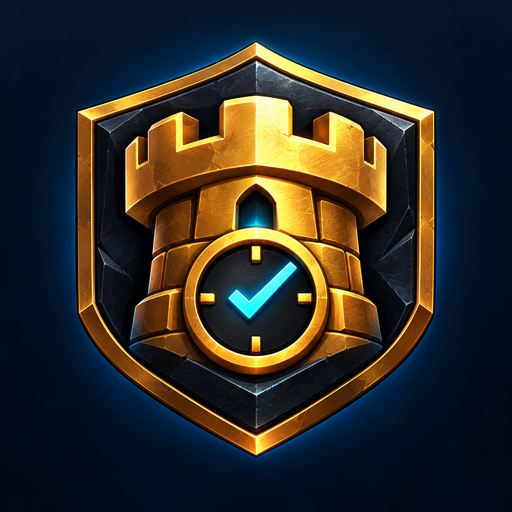
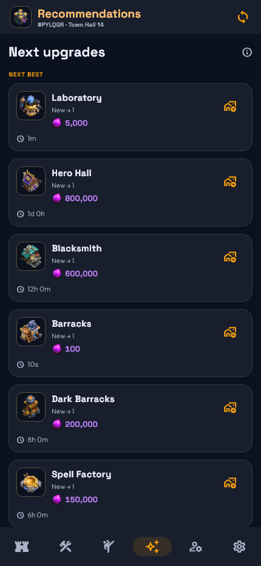

<p align="center">
  
</p>

<h1 align="center">🛡️ COCTracker</h1>
<p align="center">Your villages. Your upgrades. One quiet dashboard.</p>

<p align="center">
  <a href="https://github.com/saimadhav10/COCTracker/releases/latest"></a>
  
  
</p>

<p align="center">
  <a href="https://github.com/saimadhav10/COCTracker/releases/download/v3.0.0/COCTracker-v3.0.0-arm64-v8a.apk">Download Android APK</a> ·
  <a href="https://github.com/saimadhav10/COCTracker/releases">All releases</a> ·
  <a href="https://github.com/saimadhav10/COCTracker/tree/main/lib">Source code</a> ·
  <a href="https://github.com/saimadhav10">Creator</a>
</p>

A compact, offline-first **Clash of Clans Home Village companion**. Import the game's JSON export, manage multiple villages, and track upgrades with persistent countdowns. No account, ads, or cloud sync.

## Inside the app

| | |
|---|---|
| 🏰 **Home** | Overall/category progress, builder upgrades, laboratory research, pets, and local completion times. |
| ⚒️ **Upgrades** | Current-TH eligible upgrades and unbuilt buildings, costs, durations, and inline icon controls. |
| ✨ **Recommendations** | The next eligible upgrades, ordered by the app's offense/prerequisite-first planning rule. |
| ⚔️ **Armies** | Troops, spells, and explicitly listed heroes from [Clash Armies](https://clasharmies.com/). Up to two Air, Ground, and Hybrid compositions per TH. Fewer when verified source entries are unavailable. |
| 👥 **Profiles** | Separate local villages with quick switching, import, rename, and removal. |
| ⚙️ **Settings** | Three dark themes, Gold Pass estimates, backup/restore, official news, and optional Android reminders. |

## Preview

  

*Preview villages are test fixtures. The app starts empty.*

## Install & import

1. Download **one** signed APK from [the latest release](https://github.com/saimadhav10/COCTracker/releases/latest). Choose **arm64-v8a** for most recent phones, **armeabi-v7a** for older 32-bit ARM phones, or **x86_64** for compatible emulators/devices. Android 8.0+ required.
2. In Clash, open **Settings → More Settings → Export Data** and copy the JSON.
3. Tap the import icon in COCTracker and paste it. Repeat for each village.
4. Start upgrades in Clash, then track them with the build/upgrade icons. Confirm completion or import fresh JSON to reconcile the game state.

Keep a backup before uninstalling or changing phones. Updates use the original signing certificate. Per-ABI APKs and small WebP assets keep downloads compact.

## Data you can trust

- Village progress comes from imported levels and known Town Hall caps, including mapped unbuilt buildings. It measures level progress, not time or resource completion.
- Catalogue costs and manual durations are maintained snapshots; selected Gold Pass boosts affect new estimates. Imported finish times stay unchanged. Expired timers wait for confirmation.
- Army counts and listed heroes are copied from public source cards, with a source link on every army. No invented slot fillers, descriptions, win rates, or player statistics. These community compositions are not guarantees of game availability or results. [Source audit](docs/army-source-audit.json).
- Reminders observe Clash launches on this Android device after you grant Usage Access. Background checks can be delayed by Android; physical-device behavior still needs user testing.

Profiles stay on your device. Network access fetches the public catalogue and official Supercell news; your village JSON is not uploaded. Crafting modules, supercharges, and special Town Hall weapon merges require fresh game imports.

<details>
<summary><strong>Build from source</strong></summary>

Validated with Flutter 3.47.8, Dart 3.13.7, and Java 21.

```sh
flutter pub get
dart format --output=none --set-exit-if-changed lib test
flutter analyze
flutter test
python tool/audit_armies.py
flutter build apk --release --split-per-abi
```

Android SDK platform 36 and Flutter's selected NDK are required. APKs are written to `build/app/outputs/flutter-apk/`. For signed builds, configure a private `android/key.properties` with `storeFile`, `storePassword`, `keyAlias`, and `keyPassword`. Keep signing files private and reuse the original release key. CI builds unsigned artifacts; install signed files from Releases.

See [architecture](docs/ARCHITECTURE.md), [asset credits](THIRD_PARTY_NOTICES.md), and [icon provenance](docs/BRANDING.md).

</details>

## Creator & credits

Built by **[@saimadhav10](https://github.com/saimadhav10)**. Game artwork belongs to Supercell; currency artwork comes from the [official Fan Kit](https://fankit.supercell.com/d/vkEdmkUCngKw/game-assets). Catalogue and additional artwork packaging: [clash-of-clans-data](https://github.com/chiefpansancolt/clash-of-clans-data). Army facts: [Clash Armies](https://clasharmies.com/). Full font and asset notices: [Third-party notices](THIRD_PARTY_NOTICES.md).

This material is unofficial and is not endorsed by Supercell. For more information see [Supercell's Fan Content Policy](https://supercell.com/en/fan-content-policy/).
