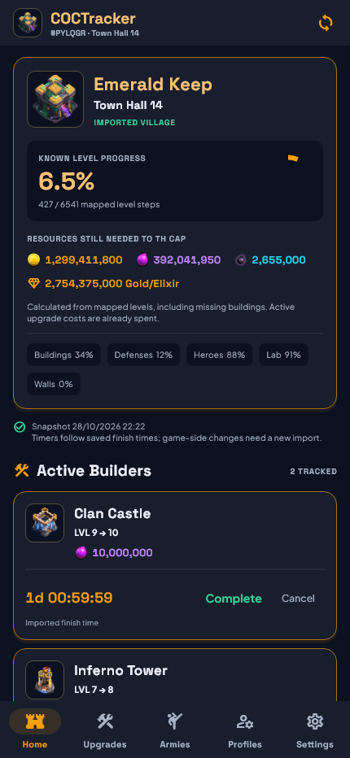
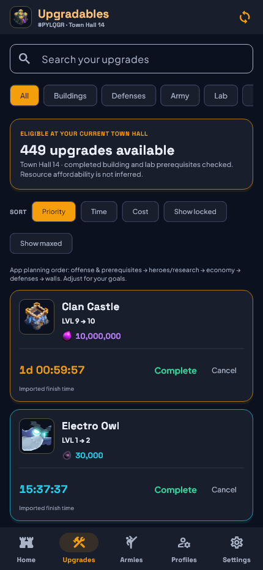
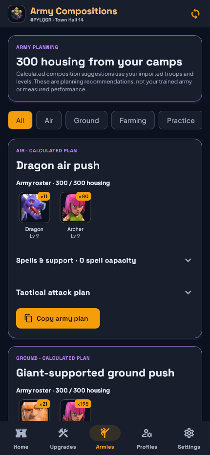

# COCTracker

A Flutter companion for your Clash of Clans Home Villages. Import the game's JSON export, follow upgrade timers, and manage multiple accounts in one local app. No sign-in, server, ads, or game credentials.

## Install

Download the signed APK from [GitHub Releases](https://github.com/saimadhav10/COCTracker/releases). Android 8.0 (API 26) or newer is required. Open the APK and, if Android asks, allow installation from the app you used to download it. Keep the same signing key for future updates.

The ARM64 v2 download is about **21.7 MB**, approximately **72% smaller** than the 77.5 MB v1 APK. ARMv7 is about 19.2 MB; x86_64 is about 23.2 MB. Install one APK matching your device.

## What v2.0 includes

- Separate village profiles with import, switch, rename, and remove controls.
- Paste in-game Export Data JSON. Matching player tags replace that profile after confirmation; older exports warn before replacement.
- Home Village buildings, traps, troops, siege machines, spells, heroes, pets, and equipment. Builder Base data is excluded. Unknown IDs and additional fields are retained.
- Offline catalogue covering TH1–18, with 183 entities and 2,650 ordinary upgrade levels. Each next upgrade shows its cost and duration.
- Eligible upgrades for the current Town Hall and completed prerequisites, including unbuilt buildings. Locked and maxed entries are hidden by default and can be revealed.
- Inline Build, Upgrade, Complete, and Cancel controls. Second-by-second countdowns persist across restarts; imported timers use the original export timestamp.
- Per-profile 0/10/15/20% builder and research discount estimates. Gems and equipment ores are not discounted.
- Dark Citadel, Onyx Black, and Midnight Purple themes based on the supplied village-inspired design.
- Calculated army suggestions using imported troop levels and camp capacity, plus app-authored upgrade priorities, farming and war preparation guides.
- Remaining resource planning by currency and known serial work estimates. Alternative Gold/Elixir wall costs remain separate.
- An About the Creator card linking to [@saimadhav10](https://github.com/saimadhav10).
- Smaller, separate ARM64, ARMv7, and x86_64 APKs with optimized WebP artwork.
- Optional check-in reminders after 24 hours without opening Clash on the same Android device, repeating at most every three hours outside configurable quiet hours. Usage Access and notification permission are needed. A tap opens Clash; the tracker does not force it open.
- Reminders to import fresh JSON when recorded upgrade timers finish.
- Device-local backup export to JSON files or clipboard, and validated restore from files or pasted JSON.
- Live official news, event announcements, and balance updates from the Supercell blog. A separate event calendar is not included.
- Settings → Refresh game catalogue downloads the maintained snapshot from this repository. Offline tracking uses the bundled or cached data.

### Using it

1. In Clash, copy the JSON from Settings → More Settings → Export Data.
2. In COCTracker, tap **Import village**, provide an optional nickname, and paste the JSON.
3. Repeat for other villages. Each player tag has its own profile.
4. Set your Gold Pass discounts in Settings, then use the inline Build or Upgrade button after starting that action in Clash. These manual countdowns use the catalogue duration with your selected discount; import fresh JSON for the game's actual remaining time.
5. When a timer expires, verify completion in Clash and confirm it in the tracker, or import fresh JSON. Expired timers never silently change levels.
6. Enable reminders in Settings, grant notifications, and use the Usage Access link to allow local Clash launch detection. Without Usage Access, upgrade-completion reminders can still work, but inactivity monitoring cannot.
7. Export a backup before changing phones or uninstalling. There is no cloud sync. Android automatic cloud backup is disabled.

## Preview

Screenshots below use illustrative test profiles, not preloaded player data.

  

## Accuracy and limits

Village state is a snapshot, not a live connection to the game. Helpers, boosts, events, purchases, and activity on other devices can make timers stale. Costs and times are community-maintained base values; verify them in-game. Catalogue refresh retrieves the repository snapshot and does not automatically ingest live game files. The snapshot's generation time and exact source revision are embedded in `assets/catalogue/home.json`.

Progress divides recorded levels by known Town Hall level caps, including mapped missing building slots at level zero. It measures known level steps, rather than time or resource completion; unmapped requirements are excluded. The import parser retains nested crafting data but does not provide a module-specific upgrade editor or specialized supercharge tracking in this release. Per-level Town Hall artwork is used; other catalogue artwork is representative and may depict a higher level.

Android can delay inexact background checks, especially under battery restrictions. Force-stopping the app prevents checks until it is opened again. Opening Clash resets the device-level inactivity clock but does not identify which profile was played. Quiet hours are interpreted in the device's local time zone.

Official news needs internet and falls back to a link to the official blog if loading fails. Army plans and priorities are planning suggestions, not measured performance: no sample win rates, fake balances, or invented account statistics are shown. Remaining work is a sum of known durations, not a completion date with parallel builders. Storage capacity checks do not claim to know your current balance.

Ordinary Ricochet Cannon, Multi-Archer Tower, and Multi-Gear Tower merges require their completed source defenses; starting a tracked merge replaces those source entries and cancelling restores them. Town Hall weapon merges, crafting modules and supercharge-specific progression require fresh game imports rather than guessed requirements.

## Development

Validated with Flutter 3.47.8 / Dart 3.13.7 and Java 21. Android SDK platform 36 and the NDK selected by Flutter are required. The included web target is a development preview; Android file pickers and usage monitoring are Android-only, and browser CORS can prevent direct loading of the official blog.

```sh
flutter pub get
dart format --output=none --set-exit-if-changed lib test
flutter analyze
flutter test
flutter run
```

GitHub Actions runs formatting, analysis, Flutter tests, native reminder unit tests, and an unsigned release APK build. CI has no private signing key: its artifact must be signed locally before installation. Install the signed APK from GitHub Releases.

### Signed release builds

Create a private Android signing keystore and put a local `android/key.properties` file beside the Android project:

```properties
storeFile=/absolute/path/to/private-release.jks
storePassword=YOUR_PRIVATE_PASSWORD
keyAlias=YOUR_KEY_ALIAS
keyPassword=YOUR_PRIVATE_PASSWORD
```

Then run `flutter build apk --release --split-per-abi`. Outputs: `build/app/outputs/flutter-apk/app-*-release.apk`. ARM64 is appropriate for most recent phones; choose the ABI supported by your device. Without a local signing configuration the build is unsigned. Signing files and APK build outputs are ignored by Git. **Back up the keystore and its passwords privately**; losing them prevents compatible updates to an installed release. Never commit them.

On Windows, if Kotlin reports incremental-cache errors when the project and pub cache are on different drives, retry without incremental compilation:

```powershell
cd android
.\gradlew.bat assembleRelease "-Pkotlin.incremental=false" "-Pkotlin.compiler.execution.strategy=in-process"
```

### Refresh the bundled data

```sh
git clone --depth 1 https://github.com/chiefpansancolt/clash-of-clans-data.git ../clash-of-clans-data
python tool/update_catalogue.py ../clash-of-clans-data
flutter test
```

Review upstream accuracy and changes before committing. Publish the refreshed catalogue to `main` for the in-app refresh action; rebuilt APKs include newly bundled artwork.

See [architecture](docs/ARCHITECTURE.md) and [third-party notices](THIRD_PARTY_NOTICES.md).

## Fan content

This material is unofficial and is not endorsed by Supercell. For more information see [Supercell's Fan Content Policy](https://supercell.com/en/fan-content-policy/). Game artwork belongs to Supercell. Currency icons come from the official [Supercell Fan Kit](https://fankit.supercell.com/d/vkEdmkUCngKw/game-assets); additional artwork and catalogue packaging use `clash-of-clans-data` under the MIT license. Space Grotesk and Plus Jakarta Sans use the SIL Open Font License. Notices are included in the repository and in-app.
